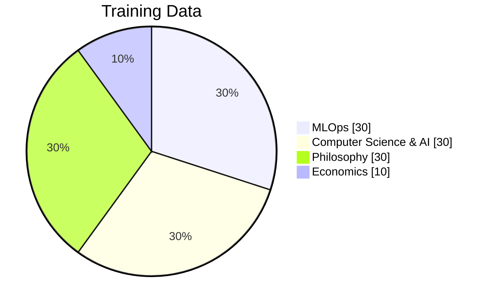
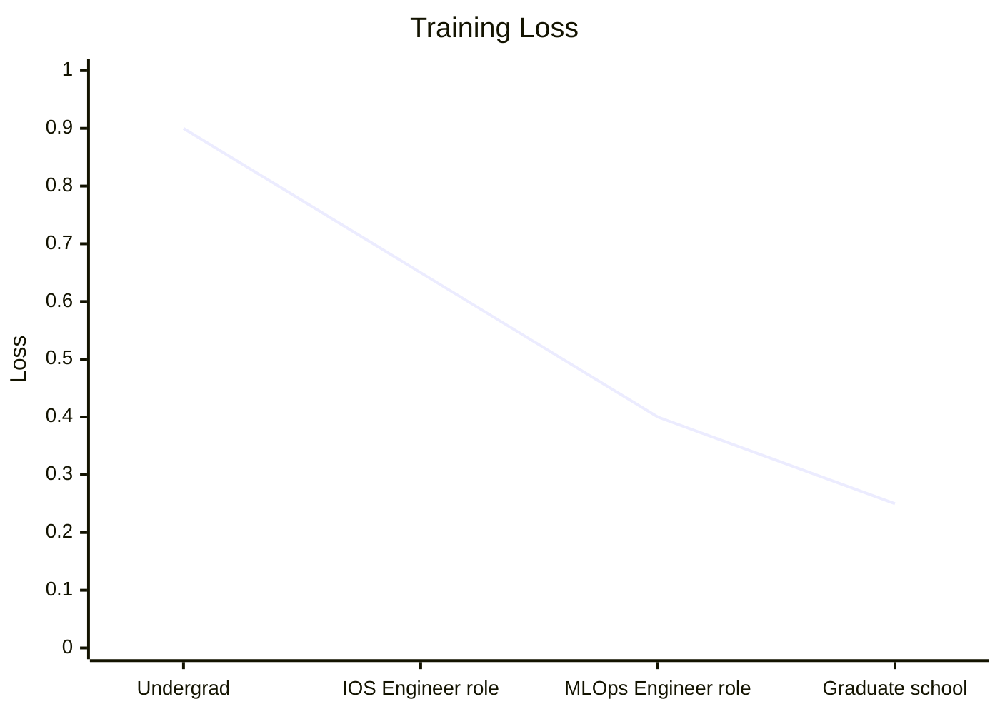
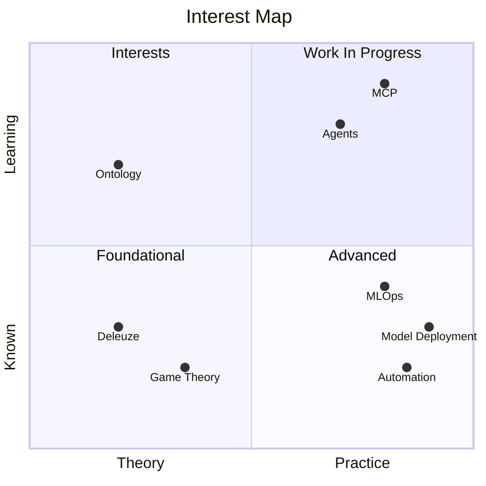
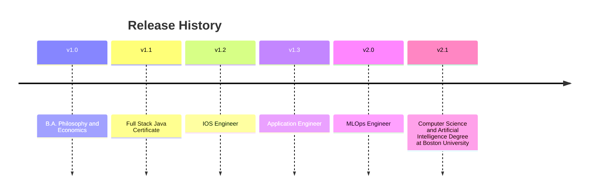

# Model Card: 'Josh-ahlers'

> MLOps engineer and Boston University Computer Science and Artificial Intelligence graduate student. Trained in Python, Java, Machine learning, and Philosophy.

--- 

## Model Details:

| Field | Value
|----|----|
|**Foundation** | Computer Science, Philosophy, andEconomics
|**Current Version** | v2.1
|**Deployment** | Data Software Engineer on the MLOps Engineering team|
|**Region** | Milwaukee


## Training Data



## Training Curve 



## Evaluation 


## Feature Space 



## Dependencies

```
# languages
python
java
C
java script
type script

# ml & data
mlflow
pyspark
scikit-learn
pandas

# mlops & infrastructure
docker
kubernetes
nginx
gitlab-ci
azure
```
## Notable Deployments
- **MLOps Plugin Framework**: Rearchitected my team's MLOps stack into a plugin based Python Framework so teams can add algorithms, data frameworks, and feature stores without touching core code.
- **Notebook to Production Gen AI Tool**: Created an LLM powered tool that turns Jupyter notebook logic into reusable Python modules and generates pytest suites.
- **MCP Gateway**: Developed a secure gateway for MCP resources servers using Azure Entra token validation and zero trust downstream authentication
- **Databricks Migration**: Moved six marketing models from Domino to Databricks.

## Known Limitations
- Takes 4 hours to record a 4 minute demo
- Uses too many emojis

## Intended Use
- Building and maintaining ML Systems
- Designing Agents and MCP integrations
- Finding new and unique ways to automate

## Version History


