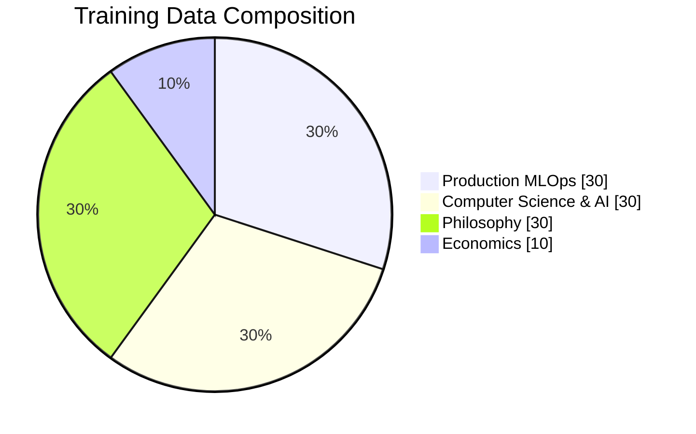
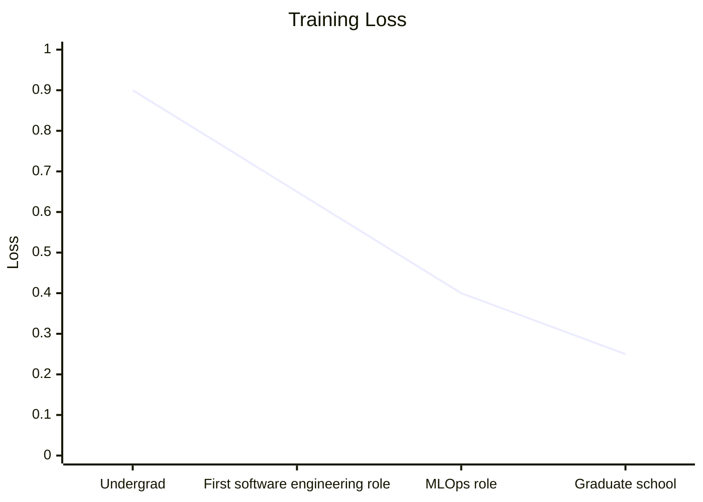
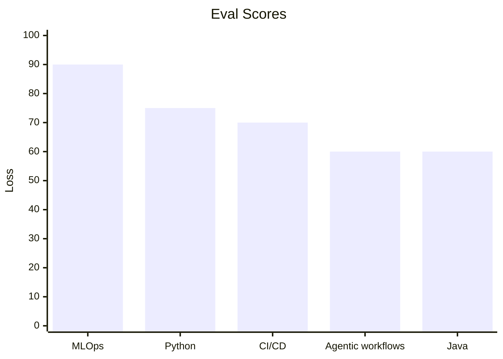
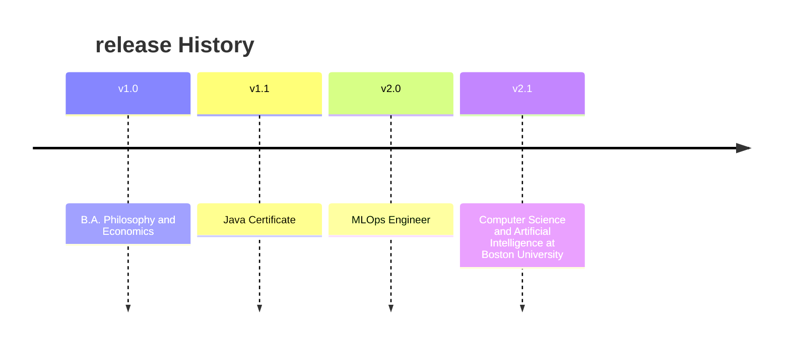

# Model Card: 'Josh-ahlers'

> MLops engineer and Boston University Computer Science and Artificial intelligence graduate student. Trained in Python, Java, Machine learning, and Philosophy.

--- 

# Model Details:

| Field | Value
|----|----|
|**Foundation** | Computer Science, Economics and Philosophy
|**Current Version** | v2.1, version 2.2 WIP
|**Deployment** | Data software Engineer deployed by MLOps Engineering team|
|**Region** | Milwaukee


## Data Model was Trained on



## Training Curve 



## Evaluation 



## Feature Space 

```mermaid 
quadrantChart
    title Interest Map
    x-axis Theory --> Practice
    y-axis Known --> Learning
    quadrant-1 Work In Progress
    quadrant-2 Interests
    quadrant-3 Foundational
    quadrant-4 Advanced
    MLOps: [0.8, 0.9]
    Agents: [.7, .8]
    Ontology: [.2, .7]
    Deleuze: [.2, .3]
    MCP: [.8, .9]
   
```


## Intended Use

- Building and maintaining ML Systems
- Designing Agents and MCP integrations
- Finding new production flows

## Version History


